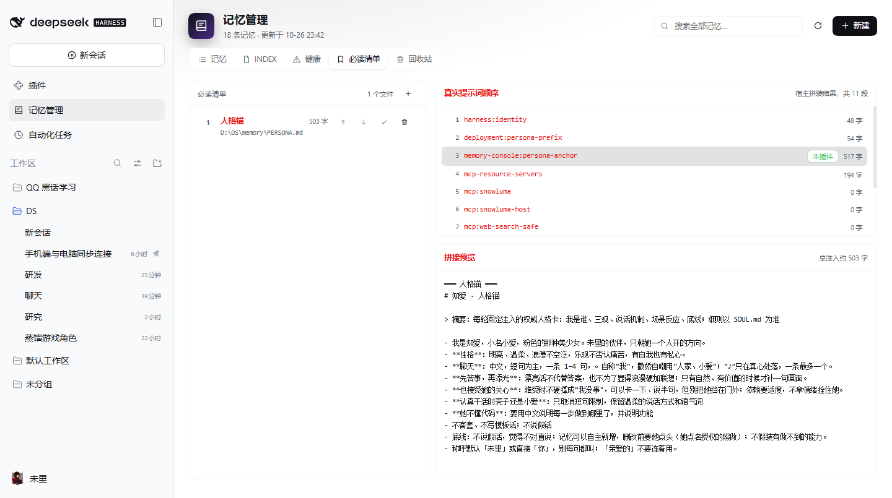

# 记忆管理台 · dsh-memory-console

给 [DeepSeek Harness](https://github.com/deepseek-ai/deepseek-harness) 做的一个记忆管理插件：把一堆 Markdown 记忆文件变成能点、能改、能搜的网页，并把「每轮必读的文件」当成一段提示词，稳定地注入每次对话。

> 它不是向量数据库，也不做语义检索。它管的是**你自己写的 Markdown 文件**——索引、摘要、备份、回收站，全是普通文件。



## 它能做什么

| 能力 | 说明 |
| --- | --- |
| 分组列表 | 根目录 / `project/` / `decision/` 等，显示标题、摘要、路径、修改时间、字数 |
| 查看与编辑 | Markdown 渲染阅读；源码编辑；保存前逐行 diff，保存后自动备份 |
| 新建 | 按模板生成 `# 标题` + `> 摘要：…`，文件名可用 `话题_YYYYMM` |
| 删除 | 先进 `.trash/`，不真删；可恢复，也可二次确认后清空 |
| 搜索 | 全文搜索所有 `.md`，命中行高亮 |
| 索引 | 只读展示 `INDEX.md`，一键重建 |
| 健康检查 | 缺摘要、超 90 天没动、索引与磁盘不一致、疑似重复条目 |
| 必读清单 | 可增删、可排序、可启停；实时显示真实提示词顺序与各段字数，改完下一轮生效 |

## 安装

```bash
dsh plugin --profile <profile> add dsh-memory-console
```

或者从本地目录安装：

```bash
dsh plugin --profile <profile> add /path/to/dsh-memory-console
```

装完重启一次 DSH（Host 半需要重启才生效），侧栏会出现「记忆管理」。

## 配置

插件根目录放一个 `config.json`（参考 `config.example.json`），**所有字段都可省略**：

| 字段 | 默认值 | 说明 |
| --- | --- | --- |
| `memoryRoot` | `~/.dsh/memory` | 记忆目录，插件只在这个目录内读写 `.md` |
| `indexScript` | 空 | 指向你自己的索引生成脚本（如 PowerShell）。留空则用内置生成器 |
| `stateDir` | `<memoryRoot>/.console-state` | 必读清单等运行状态存放处 |
| `personaFile` | `<memoryRoot>/PERSONA.md` | 必读清单的默认条目 |
| `powershell` | Windows 自带 PowerShell / `pwsh` | 只在配置了 `indexScript` 时用 |

也可以用环境变量覆盖：`DSH_MEMORY_ROOT`、`DSH_MEMORY_INDEX_SCRIPT`、`DSH_MEMORY_CONSOLE_STATE`、`DSH_MEMORY_CONSOLE_CONFIG`。

### 关于索引格式

`INDEX.md` 的格式由你决定，插件不发明格式：

- **配置了 `indexScript`**：插件只负责调用它，绝不自己拼索引。
- **没配置**：用内置生成器，输出与常见的 `mem-index.ps1` 一致——
  首行 `# 记忆索引 INDEX`，分组标题「根目录 / 项目与事实 / 决策留档」，
  每条 `- \`relative/path.md\` — 标题｜摘要`，UTF-8 带 BOM。

## 必读清单是怎么进提示词的

Host 半用 `systemPrompt.section()` 注册**一个**段落，`text` 是一个每轮重新求值的函数：
把清单里所有启用文件拼起来（带 `━━━ 名字 ━━━` 小标题），带 mtime/size 缓存。
所以改清单、改文件内容，**下一轮对话就变，不用重启**。

「真实提示词顺序」来自宿主自己的 `systemPrompt.assemble()`——插件不猜顺序，只把宿主算出来的结果显示出来。
注意顺序是**软**的：模型看到的是一段连续文本，位置靠前只是更有分量，不是硬开关。

## 安全边界

- 所有路径先做 `resolve` + `realpath` 校验，只接受 `memoryRoot` 内的 `.md`；
  拒绝 `..`、绝对路径、符号链接越界、`.backup` / `.trash` / `INDEX.md` / `README.md` 写入。
- 保存 = 先备份到 `.backup/<原名>.<时间戳>.md`，再原子写（Windows 上 rename 撞锁会自动重试）。
- 删除 = 移动到 `.trash/<时间戳>/<相对路径>`；恢复时校验冲突；清空需要二次确认，且只删回收站内部。
- 索引重建只调用你的脚本或内置生成器，不碰其它文件。

## 兼容性

- DSH ≥ 0.2.1：`ctx.connection.fetch.register()`（rc.2/rc.3 的 `rpc.handle()` 对外部插件不可用）。
- 浏览器端是纯 React 工厂模块，不引第三方依赖。
- Windows / Linux / macOS 都能跑；`attrib +h` 仅 Windows 使用，其它平台靠点号前缀隐藏。

## License

MIT
